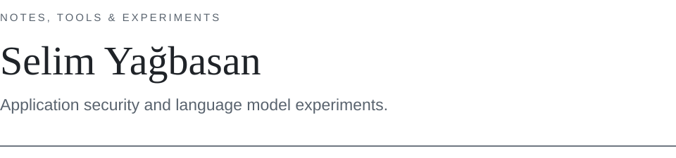

<picture>
  <source media="(prefers-color-scheme: dark)" srcset="profile-header-dark.svg">
  <source media="(prefers-color-scheme: light)" srcset="profile-header-light.svg">
  
</picture>

I build tools for application security and explore language models, with an interest in clear reporting and reproducible experiments.

## Selected work

| | Project | Focus |
| :--- | :--- | :--- |
| **01** | **[MergenScan](https://github.com/selimyagbasan/MergenScan)** | Browser-based web application security scanner with 18 test modules, severity-based findings and security reporting. |

**Testing · Classification · Reporting**

## Research interests

- Web application security and vulnerability analysis
- Security reporting and practical automation
- Language model training, evaluation and reproducible workflows

> How can we make security tools more useful and model experiments easier to reproduce?

---

[Explore MergenScan →](https://github.com/selimyagbasan/MergenScan) · [GitHub @selimyagbasan](https://github.com/selimyagbasan)
